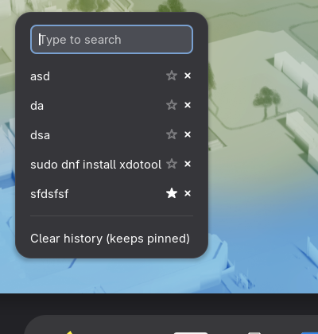

# Clipboard Popup for GNOME: Win+V clipboard history

[](LICENSE)

[](https://buymeacoffee.com/imshaaz)

A GNOME Shell extension that brings the Windows **Win+V** clipboard manager experience to GNOME: press **Super+V** and a clipboard history popup opens right where your mouse pointer is - like a right-click menu. Text and images, pin favorite entries, paste-on-select, private mode, and keyboard cycling. It is the GNOME equivalent of the Windows clipboard history popup, and a pointer-anchored alternative to top-bar clipboard indicators like GPaste or Clipboard Indicator. Works on Wayland and X11, on Ubuntu, Fedora, Arch and any GNOME 45-50 desktop.

| Popup at pointer | Panel icon | Preferences |
|:---:|:---:|:---:|
|  |  |  |

## Features

- Popup at the mouse pointer, keyboard navigable (arrow keys + Enter), scrollable at 480px max, like a context menu
- Text **and images** (screenshots, copied PNGs) with image thumbnails
- **Pin** entries so they never expire and survive Clear history
- Per-entry delete, and a Clear history action that keeps pinned entries
- **Paste on select**: the chosen entry is placed on the clipboard and Shift+Insert is simulated (works in terminals too) - the PowerToys trick
- **Cycle without opening**: next/prev entry keybindings step through history with an OSD preview
- **Private mode**: right-click the panel icon (or use a keybinding/preference) to pause recording - the icon switches to a pause glyph while it is on
- History survives reboots (stored in `~/.cache/clipboard-popup/`)
- Configurable history size and text preview length
- Lightweight: signal-driven, no polling, no subprocesses, all file IO async - zero cost while idle

## Requirements

- GNOME Shell 45 to 50 (Wayland and X11)

## Installation

From source:

```bash
git clone https://github.com/imshaaz21/clipboard-popup-gnome.git
cd clipboard-popup-gnome
make install
```

Then log out and back in (Wayland), and enable it:

```bash
gnome-extensions enable clipboard-popup@imshaaz21.github.com
```

## Usage

1. Copy text or images as usual - they are recorded automatically.
2. Press **Super+V** - the popup appears at your pointer.
3. Click an entry or select it with arrows + Enter. It is pasted into the focused window.
4. Use the ☆ button on an entry to pin it, × to delete it, or **Clear history** at the bottom.

## Preferences

Open from Extensions app or `gnome-extensions prefs clipboard-popup@imshaaz21.github.com`:

- **History size** - maximum unpinned entries kept (5-200, default 25)
- **Cache size** - total disk budget in MB for persisted history (default 10); oversized copies (text >1MB, image >8MB) are never stored
- **Text preview length** - characters shown per text entry
- **Paste on select** - simulate a paste keypress after picking an entry
- **Private mode** - pause recording; right-click the panel icon, or bind a key
- **Typeahead search** - a search row at the top of the popup filters history as you type (default on)
- **Track primary selection** - also record text selected with the mouse (default off)
- **Ignore password-manager contents** - skip clipboard contents flagged by password managers (default on)
- **Enable keybindings** - master switch for all shortcuts (default on)
- **Notify on copy** - show an OSD when new content is recorded
- **Confirm clear** - require a second click before wiping history (default on)
- **Strip text** - trim whitespace from copied text
- **Move item first** - selected entries jump to the top of history
- **Cache only favorites** - only pinned entries survive a restart
- **Shortcuts** - editable in preferences; popup (`<Super>v`), next/prev entry cycling, private-mode toggle, clear history; empty disables

The panel icon opens the popup on left-click; right-click toggles private mode. If `Super+V` clashes with GNOME's notification tray, pick another shortcut. Paste-on-select sends Shift+Insert, which terminals accept too, so it works in every app.

## FAQ

**Is there a Win+V clipboard history on Linux?**

Yes - this extension. On Windows, `Win+V` opens the clipboard history at the cursor. Here `Super+V` does the same on GNOME, and it also stores images.

**How do I get clipboard history on GNOME / Ubuntu / Fedora?**

Install this extension, then press `Super+V` (or click the panel icon). Everything you copy - text and images - is kept in the popup until cleared.

**Does it work on Wayland?**

Yes. It uses GNOME Shell's native clipboard signals, so Wayland and X11 behave identically.

**GPaste vs Clipboard Indicator vs this?**

GPaste and Clipboard Indicator open a menu from the top panel. This extension opens the popup *where your mouse pointer is*, which is what Win+V users expect, and it is the only one of the three with image thumbnails in the popup.

## Translations

The extension is translatable. To add a language:

```bash
make pot                            # regenerate po/clipboard-popup.pot
msginit -i po/clipboard-popup.pot -l <lang> -o po/<lang>.po
# translate, then make pack compiles it into the extension
```

## Privacy

Clipboard history may contain sensitive data (passwords, tokens). It is stored in `~/.cache/clipboard-popup/` and never leaves your machine; entries flagged by password managers (`x-kde-passwordManagerHint`) are skipped. History is not encrypted; the extension has no network access. See [SECURITY.md](SECURITY.md).

## Contributing

See [CONTRIBUTING.md](CONTRIBUTING.md).

## License

GPL-3.0. See [LICENSE](LICENSE).
