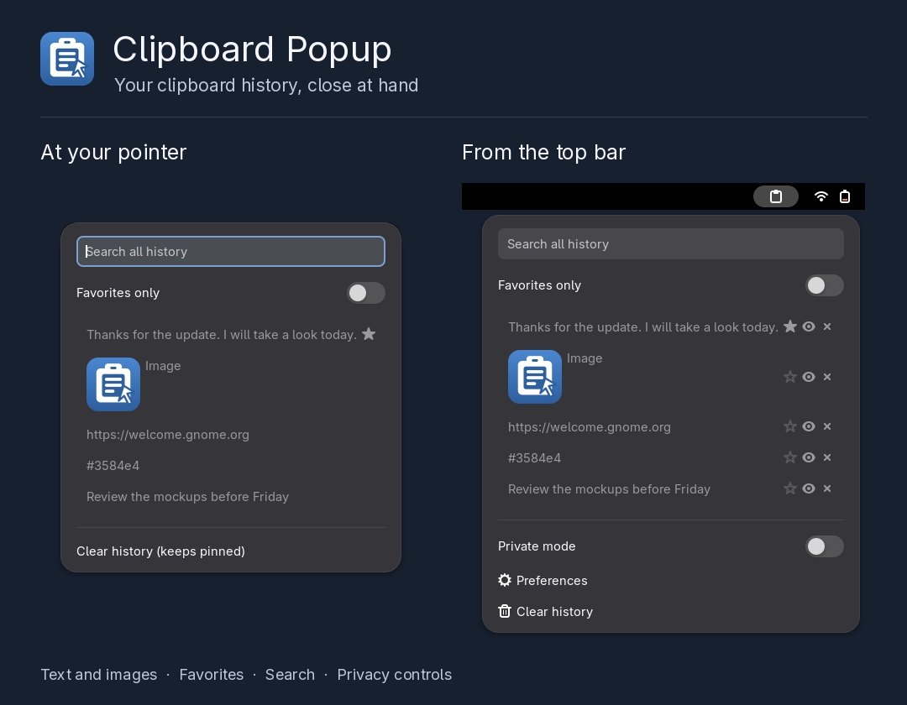
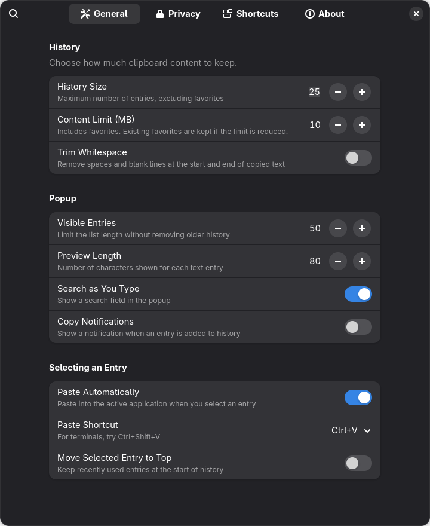
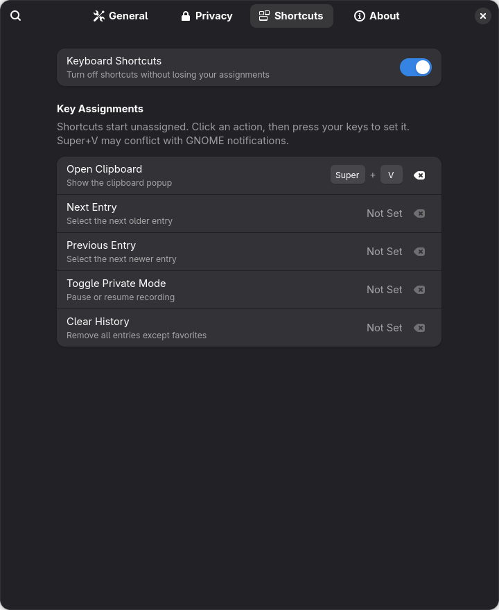
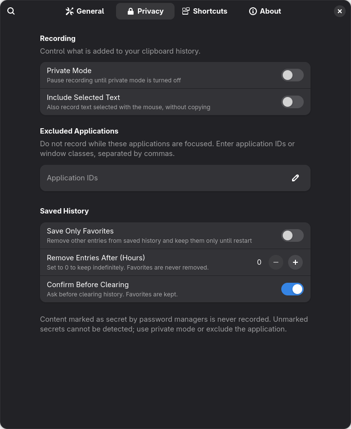
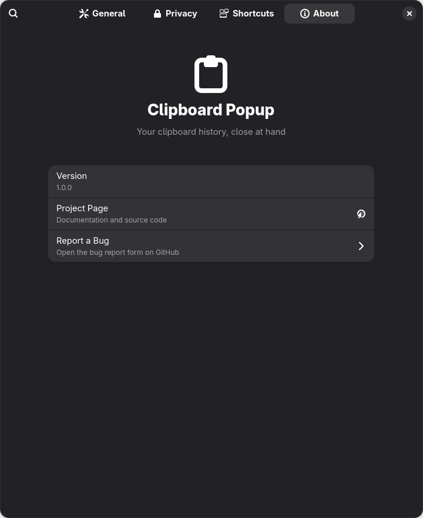
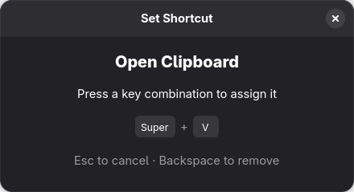

<p align="center"></p>

# Clipboard Popup for GNOME: Win+V-style clipboard history

[](LICENSE)

[](https://buymeacoffee.com/imshaaz)

A compact, native clipboard popup for GNOME, without a separate daemon or extra database dependencies. Search plain text and PNG history near your pointer or supported text cursor, pin useful entries, and optionally paste your selection.

**Shortcuts are opt-in.** In **Preferences > Shortcuts**, select **Open Clipboard** and press Super+V for Windows Win+V-style access, or use the panel icon. Super+V may conflict with GNOME's notification shortcut; choose another combination if necessary.

[](docs/screenshots/gnome-extensions-cover.png)

[Pointer popup](docs/screenshots/pointer-popup.png) · [Top-bar menu](docs/screenshots/top-bar-menu.png) · [All screenshots](docs/screenshots/README.md)

## Features

- Search the entire retained history, not just the currently displayed rows.
- Popup near the text cursor when GNOME's input-method signals provide a usable position, otherwise near the pointer or focused window. Negative monitor coordinates are supported.
- Plain text and PNG images with thumbnails, deduplication, pinning, deletion, and favorites-only filtering.
- Text previews with paging for large entries, and image previews.
- Optional paste-on-select with configurable Ctrl+V, Ctrl+Shift+V, or Shift+Insert. Paste is cancelled if focus or clipboard ownership changes, and waits briefly for held modifiers to be released.
- Private mode, focused-application exclusions, optional unpinned-entry expiry, and favorites-only persistence.
- Confirmation before clearing history from either menu or a shortcut. Clear keeps pinned entries and does not alter the system clipboard.
- Signal-driven, cancellable, size-bounded clipboard transfers. Filesystem operations are asynchronous; saves are serialized and coalesced.
- No network access, subprocesses, or additional daemon.

## Requirements

Targets GNOME Shell 45-50 on Wayland and X11. Application clipboard formats, input-method support, and paste shortcuts vary. The automated Shell integration test runs on the installed GNOME version; it does not certify every supported release or application.

## Installation

```bash
git clone https://github.com/imshaaz21/clipboard-popup-gnome.git
cd clipboard-popup-gnome
make install
```

Log out and back in on Wayland, then enable it:

```bash
gnome-extensions enable clipboard-popup@imshaaz21.github.com
```

## Usage

1. Copy text or a PNG image normally.
2. Click the panel icon, or use the popup shortcut you assigned in preferences.
3. Search, navigate with arrows, and select with Enter or a click.
4. Use the panel menu's pin, preview, and delete buttons to manage entries. Right-clicking the panel icon toggles private mode.

Within either history menu:

| Key | Action |
|---|---|
| Ctrl+1 through Ctrl+9 | Select the corresponding displayed entry |
| Ctrl+P on an entry | Pin or unpin |
| Delete on an entry | Delete that entry |
| Ctrl+Enter on an entry | Open its preview |
| Alt+F | Toggle favorites-only filtering |
| Escape | Close the menu |

Deleting text from the search field does not delete history entries. For applications that do not accept the configured paste key, turn off paste-on-select and paste manually.

## Preferences

Open **Preferences** in the panel menu, or run:

```bash
gnome-extensions prefs clipboard-popup@imshaaz21.github.com
```

Settings are organized into **General**, **Privacy**, **Shortcuts**, and **About** pages. Use the search button to find a setting across pages. About includes the installed version, project page, and bug-report form.

| General | Shortcuts |
|:---:|:---:|
| [](docs/screenshots/preferences-general.png) | [](docs/screenshots/preferences-shortcuts.png) |

Click an action and press the keys you want to use. Super+V is assigned in these screenshots as an example; fresh installs leave shortcuts unassigned.

<details>
<summary>Privacy, About, and the shortcut editor</summary>

| Privacy | About |
|:---:|:---:|
| [](docs/screenshots/preferences-privacy.png) | [](docs/screenshots/preferences-about.png) |



</details>

- **History Size:** maximum unpinned entries, 5-200 (default 25). Up to 200 favorites can be pinned.
- **Visible Entries:** 10-200 rows (default 50), applied after filtering. Refine the search to find older entries.
- **Content Limit (MB):** default 10 MB of text and PNG payloads. Pinned entries count toward it. Existing pins survive lowering the budget; new content is refused when pins leave insufficient space. JSON/filesystem overhead and decoded thumbnail memory are additional.
- **Entry limits:** 1 MiB UTF-8 text and 8 MiB PNG. PNG dimensions are limited to 16,384 per axis and 32 megapixels.
- **Preview Length:** length of the compact row, independent of full-entry previews.
- **Paste Automatically / Paste Shortcut:** optional simulated paste; Ctrl+V by default. Terminals commonly need Ctrl+Shift+V. Shift+Insert may use PRIMARY in some applications.
- **Private Mode:** stop recording new copies, including cancellation of pending reads. Existing history is not erased.
- **Excluded Applications:** comma-separated desktop IDs or window classes. Exclusion is based on the focused application, not a guaranteed identification of a background clipboard owner.
- **Remove Entries After (Hours):** zero disables expiry. When enabled, expiry is checked at startup, when opening the popup, and once per minute while enabled. Pins are kept.
- **Save Only Favorites:** new unpinned text and images stay in memory. The existing persistent snapshot is rewritten and unreferenced cached images are removed after a successful save. This is not secure erasure.
- **Include Selected Text:** optionally capture text selected with the mouse (off by default).
- **Confirm Before Clearing:** confirmation for both menu and shortcut actions (on by default).
- **Search as You Type, Copy Notifications, Trim Whitespace, Move Selected Entry to Top:** control search visibility, content-free notifications, whitespace trimming, and selection ordering.
- **Keyboard Shortcuts:** popup, next/previous entry, private mode, and clear history. Initially unassigned. Select an action and press the desired combination; no accelerator syntax needs to be typed. Esc cancels, and the remove button or Backspace in the editor clears the assignment. Duplicate bindings within the extension are rejected. The master switch disables shortcuts while preserving their assignments.

## Scope and limitations

This release intentionally restores **plain text or PNG**, not file-copy/cut operations, rich text, HTML formatting, or arbitrary multi-format clipboard content. Copying an unsupported format may not create an entry. Empty or whitespace-only text is ignored.

The extension is not the only clipboard manager with image previews or cursor positioning. [Clipboard Indicator](https://github.com/Tudmotu/gnome-shell-extension-clipboard-indicator), [Copyous](https://github.com/boerdereinar/copyous), and [GPaste](https://github.com/Keruspe/GPaste) offer broader feature sets. Clipboard Popup focuses on a compact, dependency-light workflow.

History is stored under `$XDG_CACHE_HOME/clipboard-popup/`, normally `~/.cache/clipboard-popup/`. Cache cleaners can remove it. Completed writes survive restarts; abrupt shutdown or disabling during a write can lose the latest pending changes. Malformed history is left untouched and recording is stopped rather than overwriting it. Check the Shell log if history cannot be loaded or saved.

## Privacy

History is unencrypted and can contain secrets. Files are owner-only and remain local, but this does not protect against other processes running as your user. Clipboard contents offering `x-kde-passwordManagerHint` are always skipped for both CLIPBOARD and PRIMARY. Unmarked passwords and tokens cannot be recognized reliably: use private mode, exclusions, or favorites-only persistence.

Clearing history does not clear another application's clipboard, securely erase storage, or remove backups. See [SECURITY.md](SECURITY.md).

## Verification

Development checks require Node.js 22+, GJS, and GLib schema tools:

```bash
make check
make pack
make smoke    # isolated headless GNOME Shell, GTK paste client, and preferences checks
```

`make smoke` creates temporary data, config, cache, runtime, and D-Bus environments, then cleans up only that test directory. It does not install into the active desktop. The test requires a local GNOME Shell capable of running headless.

CI also runs Shexli with pinned parser versions and requires zero errors and zero warnings. Declared clipboard access remains a manual-review finding. Automated checks do not guarantee approval by extensions.gnome.org reviewers.

## Translations

```bash
make pot
msginit -i po/clipboard-popup.pot -l <lang> -o po/<lang>.po
# translate, then make pack compiles it into the extension
```

## Contributing

See [CONTRIBUTING.md](CONTRIBUTING.md).

## License

GPL-3.0. See [LICENSE](LICENSE).
